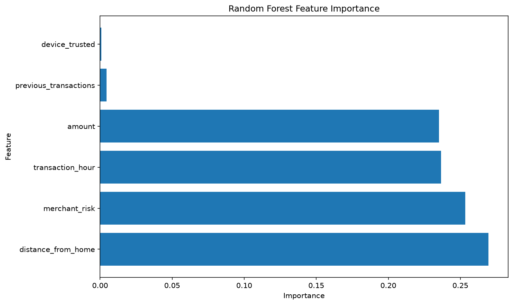
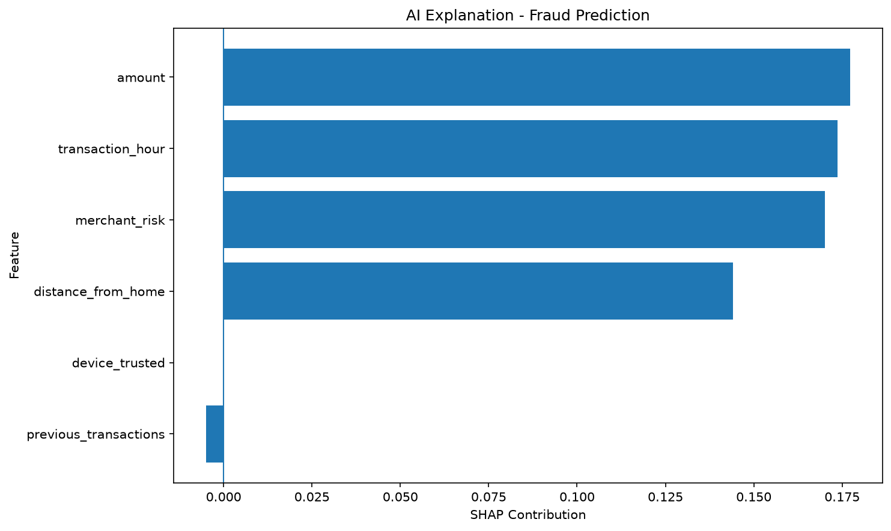

# AI Fraud Detection System

An end-to-end machine-learning project that detects potentially fraudulent card transactions:
it trains and compares models, serves predictions through a REST API, shows them in an
interactive dashboard, and explains each decision with SHAP.

**Stack:** Python · pandas · NumPy · scikit-learn · XGBoost · FastAPI · Streamlit · Plotly · SHAP · pytest

## Features

- **Synthetic dataset** of 10,000 transactions (amount, hour, distance from home, merchant risk, trusted device, history)
- **Model comparison:** Logistic Regression, Random Forest and XGBoost, evaluated on accuracy, precision, recall, F1 and ROC-AUC
- **Production model:** Random Forest (300 trees, max depth 12), saved with joblib
- **REST API (FastAPI):** `/predict` returns fraud probability and a LOW / MEDIUM / HIGH risk level, with input validation
- **Dashboard (Streamlit + Plotly):** analyze transactions, view metrics and API status
- **Explainable AI (SHAP):** shows which features pushed a single prediction towards fraud
- **Automated tests** for the API

## Project structure

```
FraudDetection/
├── src/
│   ├── config.py      # shared paths
│   ├── train.py       # dataset, training, evaluation, saves the model
│   ├── api.py         # FastAPI prediction service
│   ├── dashboard.py   # Streamlit dashboard (talks to the API)
│   └── explain.py     # SHAP explanations
├── models/            # fraud_model.pkl (generated)
├── data/              # transactions.csv (generated)
├── outputs/           # charts
├── tests/             # pytest API tests
└── requirements.txt
```

## Getting started (Windows)

```powershell
python -m venv .venv
.venv\Scripts\activate
pip install -r requirements.txt

python src/train.py                                  # 1. train + save the model
uvicorn api:app --reload --app-dir src               # 2. API  -> http://127.0.0.1:8000/docs
streamlit run src/dashboard.py                       # 3. dashboard (new terminal, API must be running)
python src/explain.py                                # 4. SHAP explanation charts
pytest                                               # run the tests
```

In VS Code, the **Run and Debug** panel has a ready-made configuration for each step.

## Example API call

```http
POST /predict
{
  "amount": 1800, "transaction_hour": 3, "distance_from_home": 400,
  "merchant_risk": 0.9, "device_trusted": 0, "previous_transactions": 1
}
```
```json
{ "is_fraud": true, "fraud_probability": 1.0, "fraud_probability_percent": 100.0, "risk_level": "HIGH" }
```

## Results

| Model | Accuracy | Precision | Recall | F1 | ROC-AUC |
|---|---|---|---|---|---|
| Logistic Regression | 84.35% | 79.11% | 73.42% | 76.16% | 0.921 |
| Random Forest | 100% | 100% | 100% | 100% | 1.000 |
| XGBoost | 99.60% | 99.41% | 99.41% | 99.41% | 1.000 |




## Limitations & next steps

The labels are generated from threshold rules on the same features, so tree models can learn the
rule almost perfectly. That is why the scores are near 100%. Real fraud data is heavily imbalanced
(often < 1% fraud) and much noisier. Planned improvements:

- Train on a real dataset (e.g. the Kaggle *Credit Card Fraud Detection* dataset) with class-imbalance handling
- Choose the decision threshold for precision/recall trade-offs instead of using 0.5
- Containerize with Docker and deploy the API + dashboard
